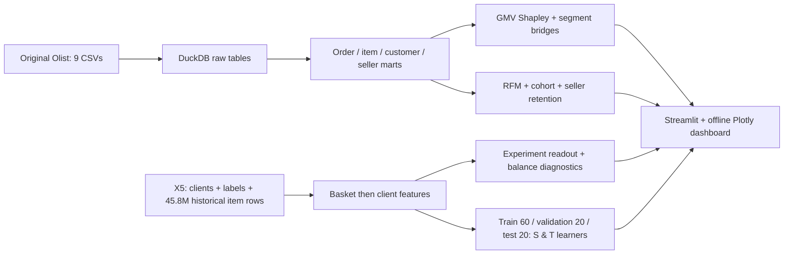

# CommerceIQ — E-Commerce Performance Diagnostics & AI-Assisted Analytics

一个个人项目：以 **Olist 真实电商交易的经营异动诊断**为主线，展示业务理解、分析工作流、AI 辅助审核和 SQL／Python 数据处理。独立的 **X5 RetailHero** 历史触达数据作为同一项目的营销扩展；不拼接两套业务。与同名商业公司无关联。

**先看成果：** [完整业务诊断与 AI 使用记录](docs/BUSINESS_CASE.md) · [中英文简历段落](docs/RESUME_CN_EN.md) · [离线交互 Dashboard](dashboard/CommerceIQ.html) · [面试讲解](docs/INTERVIEW_CN.md) · [GitHub 调研](docs/RESEARCH.md)

主线：定义业务问题 → 统一指标与检查数据 → 比较窗口 → 公式贡献分解 → 有业务理由的维度下钻 → 筛选假设 → 给出行动与取证标准。AI 用于本轮辅助编码与分析，提示词与候选可检查；复现脚本不执行模型推理，不宣称生产 API 或工时收益。

## What this project answers

- GMV fell: was it buyers, frequency or order value? Which regions/categories/sellers contributed?
- How should customers be segmented when repeat purchase is rare?
- Which sellers drive volume, service risk and next-month activity?
- Did communicated customers purchase more? What assumptions permit a causal interpretation?
- Can uplift ranking target incremental purchasers instead of customers who would buy anyway?

## Verified findings from the original data

| 分析 | 本地真实数据运行结果 | 解释边界 |
|---|---|---|
| 2018-05 → 2018-06 商品 GMV | BRL 977,544.69 → 856,077.86，**−12.43%** | 最终完成订单、下单月；非因果效果 |
| Shapley 指标树 | 人数 −9.29pp、频次 −0.20pp、AOV −2.94pp | 总贡献严格等于整体变化 |
| 口径敏感性 | 两月前28天 −9.70%；未取消口径 −13.05% | 幅度不同、方向一致 |
| 用户复购 | 主窗口内 **3.00%** 用户购买至少两次 | 首次观测并非注册，不外推 CLV |
| RetailHero 两组购买率 | Control 60.33%，Treatment 63.65%，差 **3.32pp** | 随机分配协议未独立审计 |
| Validation-selected S-learner | 独立 Test Top30 差 **6.24pp**，bootstrap 95% CI [4.31,8.02]pp | 历史 holdout；非已上线收益 |

数字来自 `outputs/`，生成口径与更多证据见 [FINDINGS](docs/FINDINGS.md)。不将地区/品类/Seller 的重叠贡献相加，不拼接 Olist 与 X5 的用户或收益。

## Architecture



DuckDB + SQL + pandas + scipy + sklearn + scikit-uplift + Streamlit + Plotly。无需云账户、数据库服务、Kaggle 私钥或 LLM API。

## Quick start / Windows PowerShell

在本项目目录运行。已准备好的本地 `.venv` 和数据可直接跳到启动 Dashboard。

```powershell
python -m venv .venv
.venv/Scripts/python -m pip install -r requirements-lock.txt

# 原始数据：Olist ~45MB + X5 历史 ~670MB compressed
.venv/Scripts/python scripts/download_data.py --x5-full
.venv/Scripts/python scripts/run_olist.py
.venv/Scripts/python scripts/run_diagnostics.py
.venv/Scripts/python scripts/build_x5_features.py
.venv/Scripts/python scripts/run_x5.py
.venv/Scripts/python scripts/render_report.py

.venv/Scripts/python -m pytest -q
.venv/Scripts/python scripts/check_dashboard.py
.venv/Scripts/python -m streamlit run dashboard/app.py --server.address 127.0.0.1
```

macOS/Linux 替换 `.venv/Scripts/python` 为 `.venv/bin/python`。环境锁定到当前验证版本（Python 3.12）；`pyproject.toml` 记录主要依赖范围。sklift 0.5.1 在 sklearn 1.9 下有 stable_cumsum deprecation warning，当前功能已验证；sklearn 暂限制 <1.10，升级后需复测。

也可一键完整重建：

```powershell
.venv/Scripts/python scripts/run_all.py
```

完整 X5 历史需额外磁盘与几分钟计算；DuckDB 内存预算 2GB，可 spill 到本项目目录，建议预留至少 6GB 磁盘。所有下载与聚合均为真实数据，失败不会回退到合成数据。若只想快速调试，可显式用 `build_x5_features.py --demographics-only`，但这会替换特征文件，结果不能与 README 的全历史模型数字混用。

离线 HTML 内嵌 Plotly，无 CDN，直接打开即可切换 6 页、缩放和悬停。Streamlit 支持月份范围、归因维度、Seller 样本阈值、样本量规划和利润假设输入。公开仓库若没有逐用户 RFM 文件，先重建 Olist；逐用户文件不提交。

## Repository map

```text
sql/                 订单/用户/Seller marts、面试 SQL、X5 历史特征
src/                 DuckDB 数据契约、精确归因、实验统计
scripts/             原始下载、GitHub 调研、两条流水线、报告与检查
dashboard/           Streamlit app + 自包含离线 HTML
outputs/olist/       GMV 桥接、敏感性、留存、Seller 与质量结果
outputs/x5/          AB、平衡、validation/test、Qini、模型卡
docs/                数据/许可、指标、实验设计、研究、面试与 SQL 练习
tests/               数学边界、真实产物契约、holdout/泄漏检查
data/manifest.json   下载源、SHA256、X5 上游 MD5
data/raw/            原始文件（gitignored）
data/processed/      X5 特征、模型、split/holdout（gitignored）
data/warehouse/      DuckDB（gitignored）
```

## Design choices that matter

1. 每个 child 表先降到 order 粒度，再 JOIN，避免 items×payments×reviews 放大 GMV。
2. Buyers 使用 `customer_unique_id`；多 Seller 的订单数不可跨 Seller 加总。
3. Shapley 平均 6 种因子替换顺序，分配交互项，贡献与 GMV 差严格守恒。
4. RFM 为固定快照规则；cohort 未观测未来格为空，Seller 首单不冒充入驻。
5. X5 重复 basket 金额先去重；全历史聚合，不截 purchases 前几行当随机样本。
6. 预处理只拟合 train；validation 固定 Top30 选 S/T，test 不选模。
7. 利润只做显式情景假设；公开数据不支持真实优惠券 ROI。

## Reuse, licensing and scope

复用 `sklift.metrics` 的 Qini/AUUC/曲线接口，参考其 X5 下载来源和 MD5；Olist 开源项目作为建模结构参考，没有复制其结论。[调研与固定代码链接](docs/RESEARCH.md) 中区分成熟算法库、少量关注的作品集和无法验证的搜索缓存。

项目新编代码使用 [MIT](LICENSE)。Olist 原始与衍生数据受 **CC BY-NC-SA 4.0**，`outputs/olist` 数据和基于其数据的图表保持该许可与 Olist 署名；代码许可证不能覆盖数据许可证。X5 原始再分发条款未确认，因此原始/客户级数据不提交。更多见 [DATA_SOURCES](docs/DATA_SOURCES.md) 与 [THIRD_PARTY_NOTICES](THIRD_PARTY_NOTICES.md)。

局限：没有流量、库存、营销曝光、真实商家入驻与退出、商品毛利/完整退货流水；不能证实缺货或流量分配因果。RetailHero 公开分组并不包含可独立审计的随机化日志；因果解释条件于相应假设。此项目不是美团或 Shopee 内部实践，不写虚构业务收益。

2026-10-05 补充诊断：相同星期结构日均 GMV 下降 7.72%；首次观测购买群体减少 122,440.30 BRL，已有购买群体增加 973.47 BRL；持续活跃 Seller 减少 120,489.82 BRL。交叉下钻及履约核查见 `outputs/olist/*diagnostics.csv`。主动构造的 AI JOIN 反例未通过金额契约，订单粒度候选通过；没有将这个反例包装成历史生产事故。

后续扩展应有明确目的：dbt 迁移用于团队模型管理，DR/X learner 用于稳健算法比较，新策略实验用于验证上线收益；首版不为展示技术而引入额外服务。
